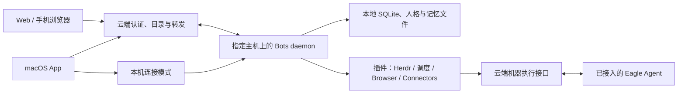

# Eagle Bots：产品方向、核心边界与分工建议

日期：2026-10-27。状态：**需求分析与架构提案，尚未实现**。

这份提案整理本次讨论中的七类需求及协作边界，不改变现有运行行为或协议。
实施顺序和当前完成状态统一由 [PLAN.md](PLAN.md#proposed-product-expansion-2026-10-27)
维护。执行某个阶段前，先同步修改 PRODUCT、ARCHITECTURE、PROTOCOL、RUNTIME 等
对应契约，再按 TESTING 的 TDD 流程实现；当前文档里的 local-only、单 Bot 单会话等
限制不能被默认为已经解除。

## 产品核心

Eagle 的主产品是可以持续工作的个人 Bot。Herdr、机器管理、浏览器和外部服务
是 Bot 可以使用的能力；Mac 和 Web 是同一批 Bot 的入口。

用户希望的是：用任何一个入口找到同一个 Bot，让它记得自己的角色和已有工作，
能定时运行，并能在指定机器上完成任务。七类需求可以归为三条主线：

1. **随处可用**：多端访问、真实机器设置、认证、Web 与本机联动。
2. **持续且有分工**：人格、长期记忆、定时与循环、创建 Bot 和群组协作。
3. **能做具体的事**：Herdr、连接器、浏览器与电脑操作。

核心先提供稳定的身份、会话、上下文和执行边界，具体能力通过插件接入。
首个阶段不需要插件市场、动态下载第三方代码、向量数据库或多主机自动迁移。

## 建议部署方式



推荐先由一台指定的常在线主机运行 Bot，持久化会话、记忆和调度任务。Mac、Web
连接同一份状态；云端保存认证配置、机器和 Bot 的位置等元数据，转发请求与事件。
聊天正文、工具结果和 Bot 记忆先由主机保存，云端不另建它们的持久化副本。
流量仍经过云端转发，这不构成端到端加密承诺。

先支持单主机作为 Bot 数据的权威来源。后续可以把不同 Bot 分配给不同主机，
但同一个 Bot 同时只由一个主机写入。不在首版引入数据同步、多主写入或自动故障迁移。
备份只恢复到一个有效写入者，不能让同一数据目录在两台机器上同时运行。

只用于访问的电脑和手机可以直接开 Web，无须安装完整 Bot 服务；执行任务的
机器仍需要执行入口。已接入的机器复用 Eagle Agent，只有 Bot 主机需要完整运行时。

当前 App 退出会停止它拥有的 daemon。多端和调度开始前，需要把 daemon 的生命周期
改为独立用户服务：App 负责连接和显示状态，关闭窗口或退出 UI 后任务仍可继续。
主机休眠、断网或关机期间，Bot 和本机提醒不可保证按时执行；界面必须显示离线状态。

pi-durable 已提供 Worker/DO 的存储与唤醒接入方式，但这不代表 Eagle 已能直接切换。
当前推荐主要基于已有 Node/SQLite 实现和本机工具依赖。DO 的费用要按实际请求、
活跃时长、连接行为和流量测量，不能直接断言比某个订阅更贵。先完成转发方案并观测成本，
需要无人值守运行时再评估常在线主机或云端运行时。

## 核心保持哪些职责

| 核心职责 | 最小设计 |
| --- | --- |
| Bot 身份与配置 | 稳定 botId、人格、启用的插件、执行目标；名字和头像只是展示属性 |
| 会话与消息 | conversationId 区分私聊与群聊，记录发送者、顺序、来源和幂等请求 |
| 运行与任务生命周期 | 复用 pi-durable，统一运行、取消、恢复和持久化任务的状态 |
| 上下文合成 | 通过接口读取规则、记忆与会话内容，限制作用域和输入大小 |
| 扩展边界 | 插件注册、配置、可用性和受限的机器执行接口 |

需先在概念和接口上分开 **Bot** 与 **Conversation**。目前实现是一个 Bot 对应一个
root conversation；过渡时将它作为默认私聊保留，不在多端接入阶段重写历史。
群聊阶段再通过兼容迁移增加共享会话，不能把多个 Bot 的私聊记录拼接成群聊。

## 插件如何极简

先采用随程序发布的静态插件注册，最小描述包含：id、version、tools、context
provider、配置定义、依赖能力、执行位置。插件用已有 pi-durable extension 接口实现，
核心只依赖应用自己的端口和类型。

Herdr 可以作为一个完整套餐：工具、使用说明、配置与本机能力探测一起注册。
它与 browser、computer、connector 使用同一类扩展边界。

每个 Bot 选择启用哪些插件。需要分别表示：

- **已安装**：程序有这份插件实现。
- **已启用**：这个 Bot 允许使用它。
- **当前可用**：选定机器在线、依赖存在且凭据/系统权限齐备。

Feature flag 控制发布或启用状态；插件注册还负责工具、上下文与生命周期。
服务端根据 Bot 配置和实际能力生成工具列表，不能只在 UI 隐藏按钮。
插件凭据通过受限配置接口取用，不放进系统提示词、模型上下文或工具返回值。

## 人格与长期记忆

首版用易读文件和现有本地存储，先实现确定的作用域和写入行为。

```text
<bots-root>/
  shared/
    USER.md              用户明确提供的公共背景与偏好
    RULES.md             用户明确设置的公共工作规则
  bots/<botId>/
    BOT.md               这个 Bot 的职责、风格、边界
    MEMORY.md            这个 Bot 的长期事实和经验
    session.sqlite       现有私聊、运行记录及恢复状态
    workspace/           这个 Bot 的工作文件
  rooms/<conversationId>/
    ...                  群组公开消息及明确共享的上下文
```

以上是**拟议的运行数据文件**，与代码仓库根目录的开发用 AGENTS.md 无关，
当前也没有创建或加载这些人格/记忆文件。

上下文由公共规则、Bot 人格、适用记忆、当前会话和已启用插件说明组合。
应用的认证、执行目标和工具权限由程序执行，不由人格文件放宽。外部网页和工具
返回内容作为数据处理，不获得修改配置和权限的资格。

| 信息 | 建议作用域与修改方式 |
| --- | --- |
| 公共用户偏好和规则 | 同一部署内明确共享；用户编辑，Bot 可以提出修改建议 |
| 人格、私聊、私有长期记忆 | 单个 Bot；创建另一个 Bot 不自动复制这些内容 |
| 群内消息和共享记忆 | 指定群组的成员可用；不自动公开成员的私聊历史 |
| 临时任务上下文 | 当前 run；交接时显式选择需要传递的内容 |
| 连接器凭据 | 安全配置；按插件、资源和执行目标授权，不作为记忆 |

长期记忆与聊天记录独立：重新开始会话可以保留人格与记忆。首版支持用户明确要求
“记住/忘记”、编辑和回看修改来源；自动提炼与检索增强后续再加。记忆修改需有
稳定条目标识、来源、时间和版本，原子保存；不能把整段对话不断追加进提示词。
初版先做有界文件读取和简单查找，不要求向量检索。

## 逐项分析

| 需求 | 最小可用切片 | 主要依赖与边界 |
| --- | --- | --- |
| 多设备 | Web 与 Mac 访问同一台主机上的同一 Bot、同一历史 | 常驻 daemon、云端认证/转发、断线恢复；首版不做主机间同步 |
| Bot 创建 Bot | 一个受限工具调用核心创建 API，指定职责和可用插件 | 创建数量、并发、深度和预算有上限；权限不能超过创建方获准范围；创建请求幂等 |
| Group chat | 单个持久化群消息流，先用 @指定 Bot 或主持者轮流调度 | 消息发送者和顺序明确；支持停止；限制轮数/预算，避免 Bot 相互无限触发 |
| 手机 | 先用响应式 Web；后续按通知、后台与系统能力需求评估 PWA 或原生 App | 不把原生 iOS App 设为多端访问的前置条件 |
| 计时和 loop | 持久化的一次性提醒与固定周期任务，支持列表、暂停、取消 | 时间/时区明确，重启恢复，主机离线后的逾期策略；具体任务可插件化 |
| Computer/browser use | 先完成一个有来源链接的 X 信息整理流程，再扩大操作范围 | 有可用 API/授权时先用连接器，否则按需使用浏览器；全桌面控制另做插件 |
| 人格和长期记忆 | 接通独立 Bot 指令、公共规则与按作用域保存的长期记忆 | 核心上下文接口先稳定；行为规则与记忆实现可以迭代，避免提前搭知识平台 |
| Cloudflare、X 等连接器 | 每次完整交付一种连接器和一个实际任务 | 注册工具、受限凭据、配置界面和能力探测；Cloudflare 连接器与 Eagle 的托管部署职责分开 |

定时任务不能依赖打开的 App 或一个未持久化的 setTimeout。保存任务后显示确定的
到期时间；触发、取消与完成均落盘。主机恢复后，一次性提醒补发一次并标记延迟，
周期任务默认跳过错过的时间段，避免连续补跑。每次触发有独立 occurrence ID。
通知与外部副作用需要各自的去重处理，不能承诺任意操作恰好执行一次。

“Loop”需要分成两种：固定间隔触发由调度器处理；持续尝试完成目标由有轮数、
耗时和调用预算的任务处理。等待阶段不反复请求模型，两种都能停止。

Browser 和 computer use 分别实现：浏览器可从结构化页面/API 开始；桌面操作涉及
目标主机的屏幕与辅助功能权限。执行能力由目标机器声明，Web 不自动具备本机权限。
X 的数据可用性取决于实际授权和接口条件，信息整理结果需保留来源和采集时间。

## 双人分工建议

先固定模块责任，再把名字填入；粘贴的讨论没有完全确定每句话的发言者。
如果用户希望亲自决定人格、记忆、协作体验，可以主负责 Bot 核心；nocoli 负责
云端与机器接入。已有分工若相反，交换负责人即可，模块边界保持一致。

| Bot 核心负责人 | 云端与机器接入负责人 |
| --- | --- |
| Bot、Conversation、群组和运行状态 | 部署级认证、客户端会话、机器目录和在线状态 |
| pi-durable 适配与本地持久化 | Bot 主机的出站连接和云端转发 |
| 人格、记忆作用域与上下文合成 | macOS 机器设置页接真实 API，移除该区域 mock |
| 插件注册和每 Bot 的启用选择 | 已有 Agent/实时桥接的适配与升级路径 |
| Bot 管理、群聊、调度及插件业务语义 | Web Bot 聊天 UI 和远程连接 transport |
| Bot 模型、人格、记忆、群聊、任务的本地 UI | 机器命令的执行协议、结果查询、取消和证据 |

建议文件分区：核心侧主负责 `apps/bots` 及 BotsCore/BotsFeatures；云端侧主负责
`apps/web`、`packages/agent` 和原生机器设置。BotsTransport、daemon 接线文件和
协议/fixtures 指定一位集成负责人，双方评审接口，避免同时改同一条链路。
Web 继续使用现有 Basalt 和既有构建方式。

当前 Bots 与网站、Worker、Agent 的独立构建和依赖方向继续保留。Web 接入属于
本次需求明确提出的协议边界扩展，实施时同步澄清根 AGENTS.md 的协议隔离表述和
对应架构契约。拟议集成通过明确的网络协议、独立适配器与兼容 fixtures 完成；
不把 Bots 领域代码导入 Worker，也不把机器采集、云端认证代码导入 Bot 核心。
双方先确定协议接入方式，再分别实现适配器。

## 开工前双方要约定的三个接口

1. **Bot 服务接口**：目录、发送/订阅/历史、取消、状态、能力、错误。私聊保留现有
   v1；新增群组等字段必须兼容，必要的新协议单独版本化。全链路沿用 requestId/trace，
   由 Bot 主机持久化接纳并返回回执，云端转发不伪造接纳。
2. **机器执行接口**：目标 machineId、能力发现、启动、输出、退出状态、取消和
   按 operationId 查询。幂等 ID 防止传输重试重复创建操作；进程崩溃后的外部副作用
   必须允许结果未知，不能自动重跑。已有终端输入接口继续保持不重放语义。
3. **插件接口**：安装/启用/可用状态、工具与上下文、凭据引用、执行目标和取消。
   核心表达“调用某项能力”，云端/执行适配器负责在哪里、通过什么通路完成它。

现有 Eagle Agent 通路已支持采集以及独立实时桥接的终端输入和画面回传，
不是通用的 command.run 任务 API。把机器执行做成结构化能力时需要新增协议、
实现、测试和兼容升级；Agent 行为或协议变化仍要版本递增并验证发布版本。
实现完成与 npm 发布、服务升级、线上验证必须分别报告，不能由一项推断另一项。

## 单用户认证与离线语义

一个部署服务一个所有者，不增加团队、多租户或角色管理。提案中的 service token
指部署级所有者凭据，不复用机器 Agent token。若采用 Cloudflare Access Service
Token，需要按它的具体凭据形式接入；当前代码的 Access JWT 校验不会自动支持它。

原生端凭据放安全配置；Web 通过 HTTPS 请求提交 token，换取安全的 HttpOnly
会话 Cookie。token 不进入 URL、浏览器持久存储、聊天上下文或日志。WebSocket
握手使用同源会话并校验 Origin。机器保留独立可撤销的身份，不能把部署所有者
凭据下发给每个执行插件或模型。

主机向云端发起出站连接，不要求把 Mac 端口暴露到公网。云端能区分主机离线、
机器离线和 Bot 运行失败。首个远程切片不增加云端离线任务队列：消息未获主机
持久化回执时显示待发送或失败，重连后按请求身份核对已有接纳状态。
主机离线后仍不能通过它执行 Bot 工作；未来的云端队列或常在线运行时另行设计。

## 首批可演示的结果

- 在未安装 Eagle App 的另一台电脑打开 Web，输入部署凭据，找到 Mac 上的 Bot；
  两端看到同一段对话，流式响应和断线恢复一致。
- 退出 macOS UI 后，在线主机上的 Bot 服务继续工作；重新打开可恢复状态。
- 为 Bot 指定人格并让它记住一条事实；重开对话仍可使用，另一个 Bot 不自动获得
  它的私有记忆；用户明确设置的公共偏好可被两者使用。
- 创建一分钟提醒，重启 daemon 后任务还在；主机在线且系统通知权限可用时到期
  提醒一次；取消后不触发，逾期恢复能说明延迟。
- Bot 使用一个已启用插件，在已接入机器上执行约定的演示操作，结果能区分
  接纳、运行、完成、失败与未知；机器断线时不会改投其他机器。

这些结果是后续阶段的验收目标，本次没有执行真实远程控制、部署、发布或任务创建。
本次只做需求分析与文档；不把历史测试数字或配置当作新功能的成功证据。
