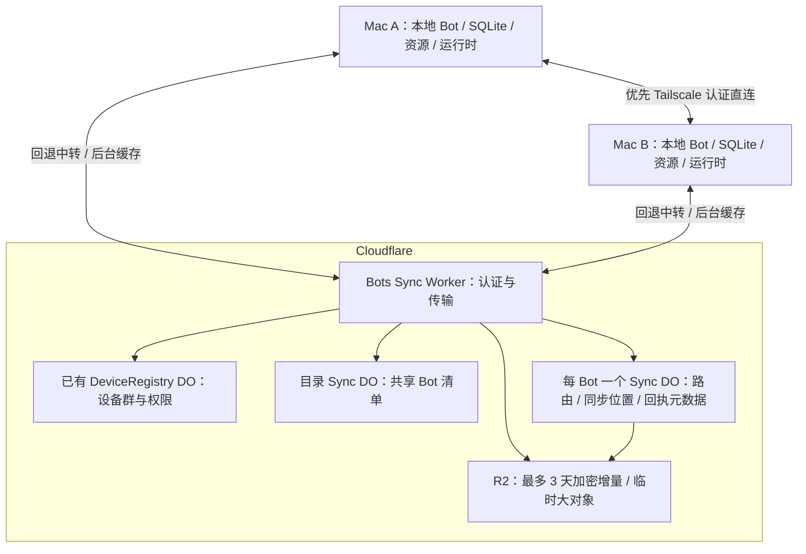

# 多端 Bot 同步架构

2026-10-30 · 架构提案，尚未实现。

**历史长期保存在各设备，Tailscale 直连优先、Cloudflare 中转兜底；共享对话保留并发分支。**
同一个 Bot 在 A、B 各有独立副本与运行时；A 离线或云端不可达时，
已就绪的 B 仍可使用本机已有历史运行，模型和工具环境由 B 提供。
云端加密增量最多保留 **3 天（72 小时）**，不长期归档聊天正文、摘要或完整基线。

开发基线为个人 fork 中的 `bot-sync/base@165d154`，已包含 `nocoo/main@d69359b`
与 [#109](https://github.com/nocoo/eagle/pull/109)。复用其设备群、配对、身份和后台
服务；新增同步能力独立提交，后续单独发 PR。具体边界见 [PLAN.md](PLAN.md#开发基线与-pr-边界)。

## 架构

UI 连接本机 daemon，消息先在本地保存并执行。DO 中转消息，仅持久保存目录、
同步位置及回执元数据，不把消息正文写进 DO SQLite。本地回复不等待云端 ACK。

Bots Sync 独立构建、部署，通过版本化接口复用 [设备服务](../DEVICES.md) 的身份和 Registry；
不耦合网站、Agent 或报表 D1。首个闭环无需 D1、KV、Queues。
现有 `SharedDevicePort` 用于设备执行；同步握手、密钥分发和端点发现另行定义，
helper 保管私钥，现有受限注册签名不直接用于同步载荷。
传输设计参考 Eagle 现有 [LiveRelay](../../apps/web/src/worker/realtime.ts) 的出站连接、
鉴权与中转机制；新 Bot 缓存规则独立于现有机器采集、实时终端和日报契约。

## 连接选择

- 优先连接已配对设备的 Tailscale 地址；没有地址、不可达或连接失败时使用 Cloudflare。
  设备服务在群内发布地址与端口；专用同步入口仅向 Tailscale 网络开放，不要求安装或登录 Tailscale 才能使用 Eagle。
- 直连必须验证设备公钥、群成员授权与加密握手，不能只凭 Tailscale IP 信任对端。
  两条路径遵守同一授权规则，切路不能绕过认证失败。
- 参考 Orca，建议直连建连/握手等待 2.5 秒后启动中继竞争；已知网络失败立即回退。
  中继期间建议本机每 15 秒探测直连，连续成功并满足稳定窗口后切回，避免频繁换路。
- 两条路径共用事件 ID、应用游标和去重规则；新连接认证完成再切换，用连接代次隔离旧回调。
  不更换 run 身份、不重新提交模型或工具；这些等待不阻塞本机执行。

直连只优化在线传输，新增持久增量仍后台进入 3 天云缓存，供其他设备错峰补齐；
直连的对端 ACK 不代表云端已缓存。大文件和历史补读也优先直连，失败经中继透传。
这里的直连指不经过 Eagle 云中继；Tailscale 底层仍可能使用 DERP，不保证物理 P2P。

## 数据与运行

| 数据 | 保存与共享方式 |
| --- | --- |
| Bot 定义、模型选择、工具配置 | 各端保存版本，跨设备同步 |
| 原始消息、工具结果、附件、分支、压缩记录 | 各端持久化；云端透传或限时缓存，保留期后从在线副本补齐 |
| Bot 专属指令、`AGENTS.md`、Skills | 各端保存并传输完整版本；技能包含 `SKILL.md`、脚本和引用文件 |
| 活动任务、待执行队列、provider 会话 | 仅保存在该 run 的执行设备 |
| 工作区、项目规则、程序、权限、API key | 本机绑定或配置；私钥和凭据留在安全存储 |

每台设备分开保存副本库与运行库：副本库管理共享历史、同步位置和 outbox，
运行库管理本机 pi 会话与任务。同步交换事件，不复制活动 SQLite。

同一个 `botId` 可同时有多个 `runId`；每个 run 固定执行设备、历史 head 和资源版本。
资源校验、完整落盘并实际加载后才可用；并发配置修改保留冲突，可沿本机已选版本继续。

顺序使用时接续已收到的历史；A、B 同时从 H 开始时保留 `H → A1`、`H → B1` 两支。
默认沿当前分支继续，显式合并创建引用两支的新上下文节点，记录编排方式、保留原文。
上传时间不决定对话顺序，迟到消息不改写已有 run 实际使用的上下文。

历史导入只产生记录，不重做模型或工具调用。A 的运行结果未知时，B 可从已有完整
head 开新 run；原操作仍按原 ID 查询。文件修改及外部副作用由目标系统处理冲突。

## 同步与恢复

1. **本机接纳**：同一事务保存输入、run 意图及 outbox；以稳定请求 ID 交给运行时。
2. **异步发送**：本机输出落盘后导出事件，优先经认证的 Tailscale 直连；不通则走云中继。
3. **缓存与补发**：新增增量独立后台缓存，先保存对象再发布带到期时间的引用。
4. **另一端应用**：验证、解密、补齐依赖，事务保存事件与应用位置；随后可用于新 run。

事件以 `replicaId + epoch + seq` 定位，消息以 `itemId + revision` 标识。
重连从已应用位置补读缺口；备份恢复使用新 epoch。删除保留 tombstone，
旧副本重建时保留其未上传分支，不能让旧数据复活已删 Bot。

持久确认是**本机已保存、另一端已应用**；“云端已缓存”必须带到期时间，
不能当作备份，也不代表执行完成。已见过的位置与当前仍可补发的范围分开记录。
运行库与副本库之间通过幂等接纳、持久 ID 映射和条目扫描补导出恢复；
DO 与 R2 不假设联合事务；源端保留本地历史，不因缓存 ACK 删除唯一副本。

保留期从服务端首次缓存成功起计算：`expiresAt = firstCachedAt + 72h`。
到期停止补发并删除对象；重试、读取和设备离线均不续期，清理失败重试必须验证。
旧历史与完整基线从在线副本分块透传，不通过反复上传延长云端保留；日志不记录正文。

已具备基线的设备可在 72 小时缓存有效期内错峰同步。缓存过期后向在线副本补读；
这改变缺失数据的获取方式，不限制已有本地副本发起新 run。

新设备流程：**配对入群 → 获得密钥 → 发现 Bot → 向在线副本取基线和资源 → 落盘 → 补读增量**。
缓存过期后，缺失历史可从任一持有它的在线设备补齐，不绑定创建设备。
没有这样的在线设备时先等待补齐；已有可运行副本仍能继续，只使用本机已知上下文。
可运行基线必须包含所选历史的完整依赖；UI 最近消息窗口不能替代原始上下文。
模型窗口裁剪与压缩保留来源，不承诺模型未暴露的内部状态能够迁移。

内容在端上加密，云端只见密文及必要路由元数据。已有成员向新设备分发密钥信封；
所有旧设备离线且尚无信封时，需要恢复凭据。撤销阻止后续共享并轮换密钥，
不能擦除已下载历史，也不停止已有本地副本运行。

## Orca 可借鉴的机制

已拉取并核对的源码基线：`6b937c7e5f5a8d2cfcb755c6708ac38a632b3012`。
下表链接固定到该提交，区分 Orca 已有机制与 Eagle 的应用方式。

| 机制 | Orca 做法 | Eagle 如何采用 |
| --- | --- | --- |
| [目录同步][orca-catalog] | 先快照、后增量，扫描期间缓冲变化 | 群目录发现 Bot；目录与 run 状态分开 |
| [持久日志][orca-journal] | SQLite journal 按会话、epoch、seq 排序，事务提交后发布 | 每副本独立来源日志，先落盘再同步 |
| [断线补读][orca-catchup] | 从已应用游标恢复，失效时 reset，有界窗口外另行分页 | 先取仍有效的缓存，缺口向在线副本补读；基线声明覆盖范围 |
| [命令去重][orca-receipts] | 持久操作 ID、内容指纹和结果回执 | 重试沿用原 ID；未知结果先查询，避免重复执行 |
| [连接恢复][orca-transport] | 手机直连/中继切换，隔离旧连接回调 | Tailscale 优先、Cloudflare 回退；恢复后稳定切回，共用游标与去重 |
| [云中继][orca-relay] | 有界内存队列转发帧，聊天历史由运行主机保存 | DO 转发、各端保存历史；3 天缓存是 Eagle 增加的补发能力 |
| [流式合并][orca-stream] | 普通 assistant 更新约 48 ms 合并，关键事件立即发送 | 合并预览更新，本地持久日志负责恢复，不逐 token 缓存 |
| [技能包][orca-skills] | manifest 固定版本与文件清单，完整包传到执行端 | 从副本传输完整包，可选 R2 临时中转；各端校验并固定版本 |

所查 Orca 手机/桌面远程会话仍在所选主机执行，中继主要转发消息并保存路由元数据；
这些路径没有证明跨运行时历史合并。Eagle 需新增**可运行本地副本、对话分支和被动导入**。
Orca 手机的 [直连入口][orca-direct] 区分 LAN/Tailscale；其自动切换机制不直接推广为所有桌面路径的现有能力。
Worker/DO 承接接入与中转，R2 仅作最多 3 天的临时存储；不采用云端完整历史库。

当前 pi-durable 1.4.0 的跨库上下文保真、多父上下文构建、整轮资源固定及崩溃恢复
仍需实现验证。详细源码证据见 [SYNC.md](SYNC.md)，交付状态见 [PLAN.md](PLAN.md)；
现有已实现契约仍以 [ARCHITECTURE.md](ARCHITECTURE.md) 为准。

[orca-catalog]: https://github.com/stablyai/orca/blob/6b937c7e5f5a8d2cfcb755c6708ac38a632b3012/src/main/runtime/rpc/methods/session-tabs-inventory.ts#L88
[orca-journal]: https://github.com/stablyai/orca/blob/6b937c7e5f5a8d2cfcb755c6708ac38a632b3012/src/main/native-chat/agent-session-journal/journal-row-writer.ts#L55
[orca-catchup]: https://github.com/stablyai/orca/blob/6b937c7e5f5a8d2cfcb755c6708ac38a632b3012/src/main/native-chat/agent-session-wire/agent-session-subscriber-catch-up.ts#L51
[orca-receipts]: https://github.com/stablyai/orca/blob/6b937c7e5f5a8d2cfcb755c6708ac38a632b3012/src/main/native-chat/agent-session-journal/command-receipt-table.spec.ts#L60
[orca-transport]: https://github.com/stablyai/orca/blob/6b937c7e5f5a8d2cfcb755c6708ac38a632b3012/mobile/src/transport/stable-logical-rpc-client.ts#L232
[orca-direct]: https://github.com/stablyai/orca/blob/6b937c7e5f5a8d2cfcb755c6708ac38a632b3012/mobile/src/transport/mobile-endpoint-lifecycle.ts#L90
[orca-relay]: https://github.com/stablyai/orca/blob/6b937c7e5f5a8d2cfcb755c6708ac38a632b3012/cloud/apps/relay/src/splice-forwarder.ts#L47
[orca-stream]: https://github.com/stablyai/orca/blob/6b937c7e5f5a8d2cfcb755c6708ac38a632b3012/src/shared/structured-agent-session-coalescer.ts#L8
[orca-skills]: https://github.com/stablyai/orca/blob/6b937c7e5f5a8d2cfcb755c6708ac38a632b3012/src/shared/skill-package-manifest.ts#L14
